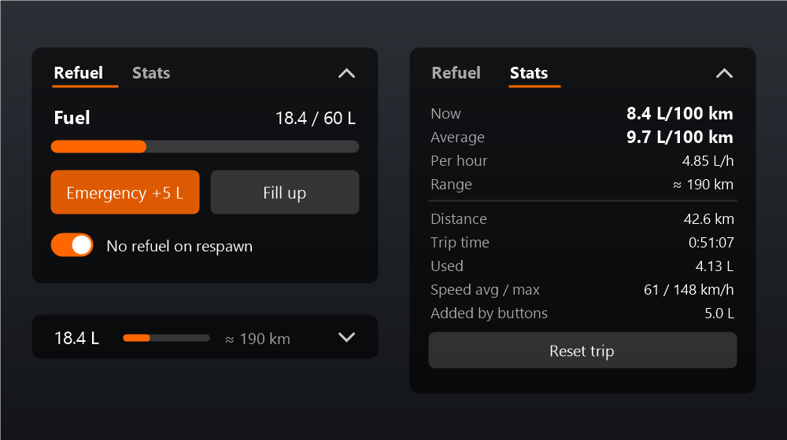

# Real Fuel

A BeamNG.drive mod that stops the free refuel on respawn, with a small fuel window: emergency 5 L refuel, fill up, L/100 km consumption and trip stats. English and Russian.



## Features

- **No free refuel on respawn.** After a reset (R), a reload (Ctrl+R) or a part change the vehicle keeps the fuel it had. A switch in the window turns this on and off; the setting is saved.
- **Emergency refuel.** Adds 5 L (never more than the tank holds). Electric vehicles get 5 kWh.
- **Fill up.** Fills every tank (or battery) to the top.
- **Stats tab** (a trip computer):

  | Row | What it shows |
  |---|---|
  | Now | instant consumption, L/100 km (smoothed over ~1.5 s); "standing" when stopped |
  | Average | trip consumption, L/100 km, idling included |
  | Per hour | L/h, useful when idling or in traffic |
  | Range | km left, from the consumption over roughly the last 10 km (shown after 1 km) |
  | Distance | trip distance, counted like the game's odometer |
  | Trip time | h:mm:ss |
  | Used | fuel used on the trip |
  | Speed avg / max | average speed counts moving time only |
  | Added by buttons | fuel added with Emergency and Fill up |

  **Reset trip** clears everything except the range, which keeps its own history.
- **Collapsible.** The arrow in the corner folds the window into one line: fuel, a small gauge and the range.
- Traffic, police and AI opponents are left alone, so they never run dry.
- Electric vehicles show kWh and kWh/100 km. Regenerative braking lowers the consumption.

## Install

**BeamNG.Earth Add-ons page:** Settings → Add-ons → **Add from GitHub** → paste `yungdmize/RealFuel` → Install.

**By hand:** download `realfuel.zip` from the [latest release](../../releases/latest) and drop it, still zipped, into the `mods` folder of your BeamNG user folder (`%LOCALAPPDATA%\BeamNG\BeamNG.drive\current\mods`). Remove older copies (`realFuel.zip`, `realFuel-*.zip`) so two don't load.

Then add the window in game: UI Apps → Add app → **Real Fuel**.

## Language

The texts follow the game's language: Russian when the game is in Russian, English otherwise. The translations are in `realFuel/locales/translations/<language>/realFuel.translation.json`; another language is one more file in a folder named like the game's own (`de_DE`, `fr_FR`, ...).

## Notes

- Made for freeroam on BeamNG.drive 0.40. Career has its own fuel system and was not tested.
- Settings are kept in `settings/realFuel.json` in the user folder.

## Building

`build.ps1` packs `realFuel/` into `realfuel.zip` (forward-slash names, the game's folders at the top). `-Install` also copies it into the game's mods folder.

```powershell
powershell -ExecutionPolicy Bypass -File build.ps1 -Install
```

---

## Русский

Мод для BeamNG.drive: машина больше не заправляется бесплатно при респавне. Есть маленькое окно с экстренной заправкой 5 л, полным баком, расходом л/100 км и статистикой поездки.

- **Без заправки при респавне.** После сброса (R), перезагрузки (Ctrl+R) и смены деталей машина сохраняет уровень топлива. Переключатель в окне, настройка запоминается.
- **Экстренно +5 л** (не больше объёма бака; электромобилям +5 кВт·ч) и **Полный бак**.
- **Вкладка «Статистика»:** мгновенный и средний расход, расход в час, запас хода, пробег, время в пути, израсходовано, средняя и максимальная скорость, сколько долито кнопками. Кнопка «Сбросить поездку».
- **Сворачивается** в одну строку: литры, полоска бака, запас хода.
- Трафик, полицию и AI-соперников мод не трогает.

**Установка через BeamNG.Earth:** Настройки → Add-ons → **Add from GitHub** → `yungdmize/RealFuel` → Install. Или вручную: `realfuel.zip` из [последнего релиза](../../releases/latest) в папку `mods`, старые копии (`realFuel.zip`, `realFuel-*.zip`) удалить.

Язык выбирается по языку игры: русский, если игра на русском, иначе английский.
